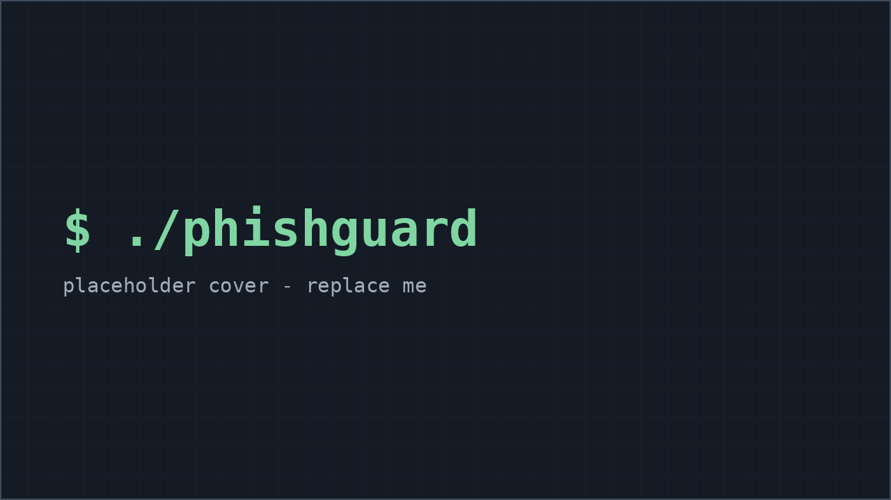

<!-- TODO: replace this whole description -->

Full project description in markdown.

## What it does

PhishGuard scores a URL and the page behind it, and flags the ones that look like phishing.

## How it works

1. Extract lexical features from the URL.
2. Fetch the page and extract structural features.
3. Score everything with a gradient-boosted classifier.

```python
from sklearn.ensemble import GradientBoostingClassifier

model = GradientBoostingClassifier().fit(X_train, y_train)
print(model.score(X_test, y_test))
```

Images stored in this folder can be referenced by file name alone:


