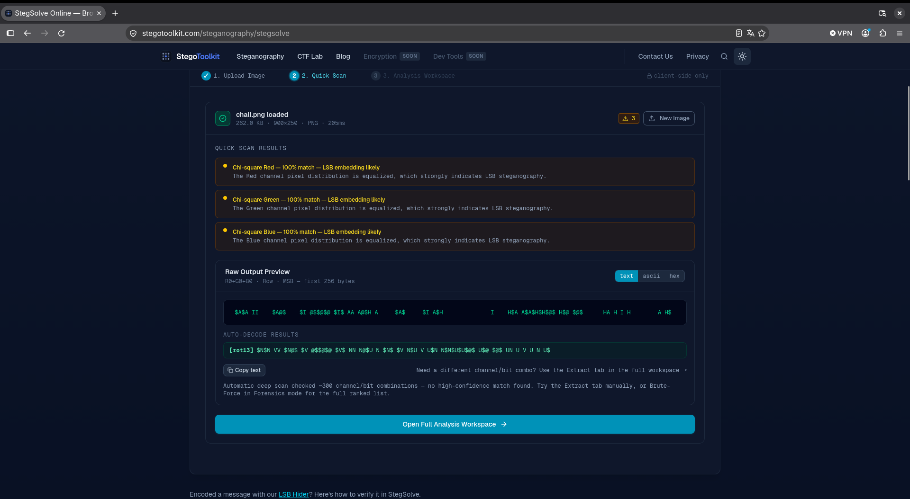
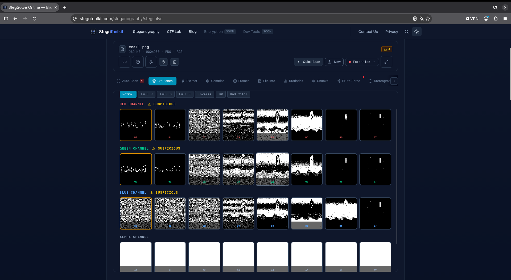
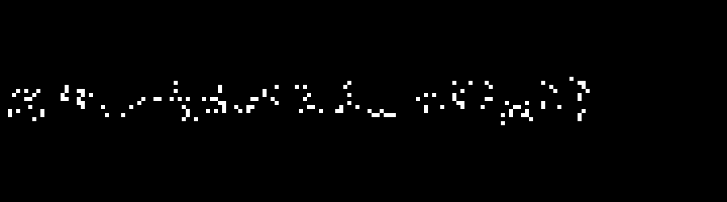
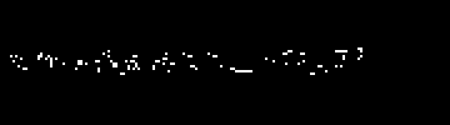
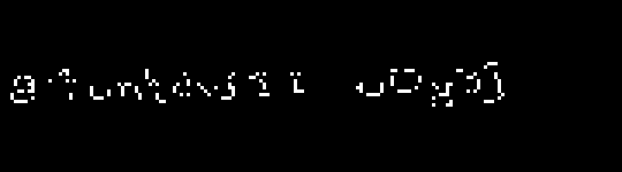
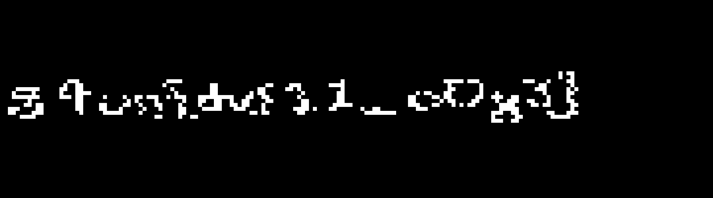
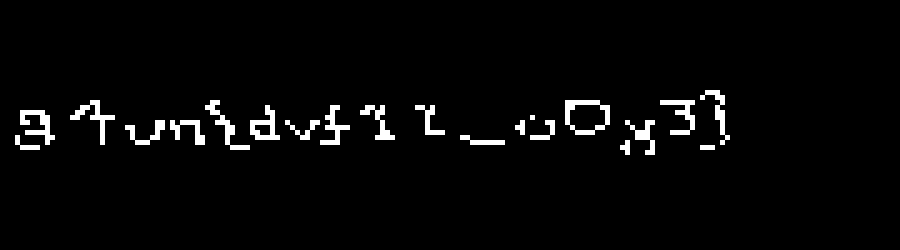
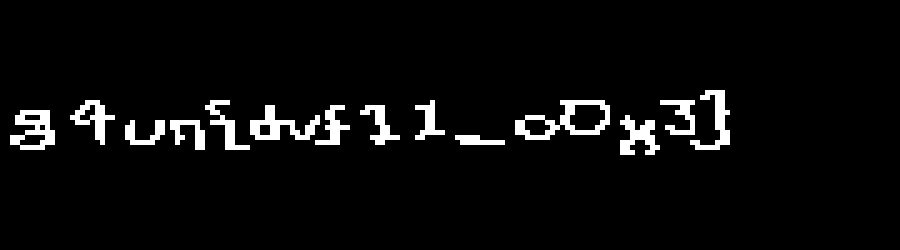
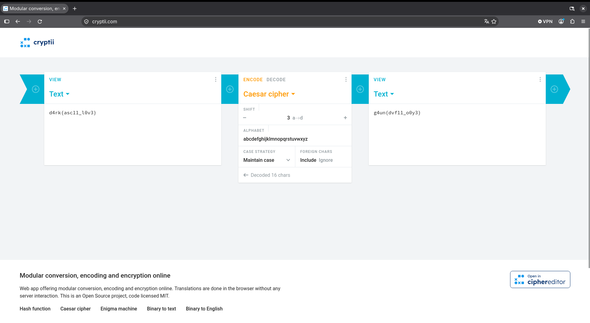

### Description

> I was never a bright student but i still read between the lines

### Solution

The challenge provides the following image. Even at first glance, faint hidden text can be seen across the middle of it.

#### Bit-plane analysis

I loaded the image into the online [StegSolve](https://stegotoolkit.com/steganography/stegsolve) tool:

In the **Statistics** tab, the chi-square test on the least significant bits flagged the red, green and blue channels as **SUSPICIOUS** (χ² = 1.00). The alpha channel came back OK, but only because the image is RGB and has no alpha channel at all.

The test only indicates that the low-order bits behave abnormally, so I moved on to the **Bit planes** tab. There, the R0, R1, G0 and G1 planes clearly stood out from the rest: almost entirely black, with a single line of text running across the middle.

I exported each of these four planes:

**Green 0**

**Green 1**

**Red 0**

**Red 1**

#### Combining the planes

Using the site's **Combine** tab, I merged the two planes of each channel with a bitwise OR:

**Combined Green**

**Combined Red**

Combining these two results with a final OR operation revealed the complete hidden text, an encrypted flag: `g4un{dvf11_o0y3}`.

#### Decryption

Comparing the prefix `g4un` with the expected flag format `d4rk` shows that every letter has been shifted three positions forward, which points to a Caesar cipher. I used Cryptii to decrypt it:

