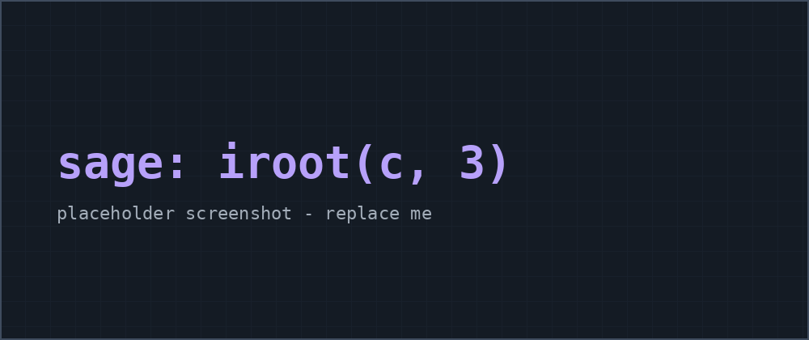

<!-- TODO: replace this example writeup -->

## Challenge

We get a public key with `e = 3` and a ciphertext of a short message.

## Solution

The message is so short that `m^3` never wraps around the modulus, so the
ciphertext is a plain integer cube.



```python
from gmpy2 import iroot

m, exact = iroot(c, 3)
assert exact
print(bytes.fromhex(hex(m)[2:]))
```
