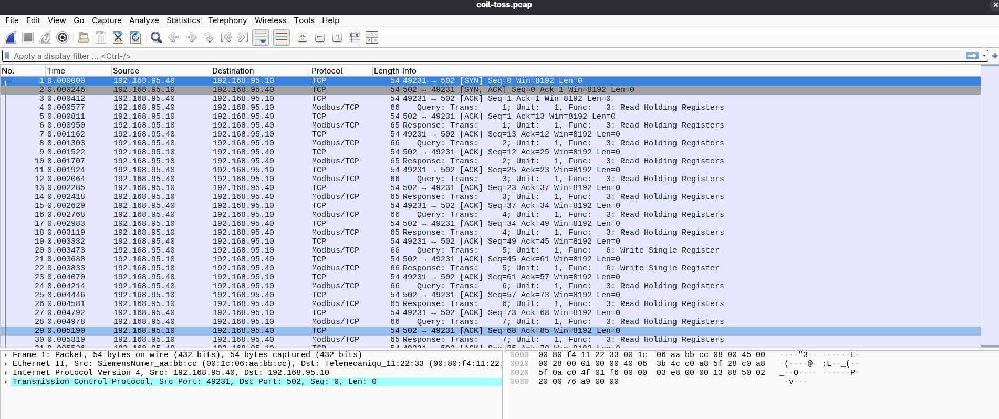
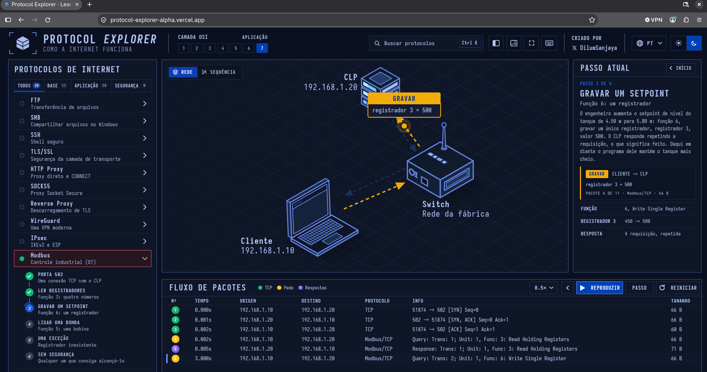
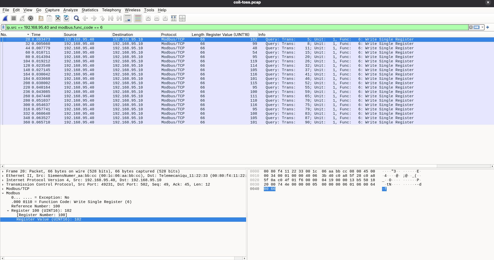
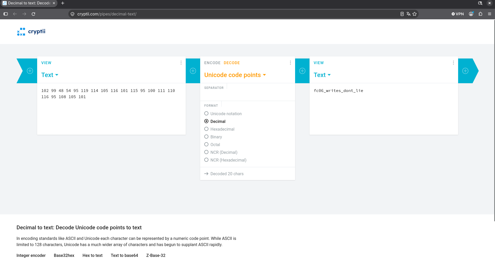

### Description

> We mirrored the link between an HMI and a PLC on a water plant skid for a few minutes. The operator swears they only 'read some gauges,' but a register on the PLC kept getting poked. Figure out what the workstation actually wrote.

### Solution

#### Identifying the protocol

I started by identifying the protocol used for communication between the HMI and the PLC, which turned out to be **Modbus/TCP**.

Using the [Protocol Explorer](https://protocol-explorer-alpha.vercel.app/) reference, I learned that Modbus is one of the most widely used protocols in industrial control systems, and that its messages are transmitted with no authentication and no encryption.

Since the description mentions a register being modified, I looked up how write operations work in the same reference and found that writing to a single register uses **function code 6**.

#### Isolating the write requests

To display only the write requests sent by the workstation, I applied the Wireshark filter `ip.src == 192.168.95.40 and modbus.func_code == 6` and added the value being written as a column:

{: width="700"}

#### Decoding the values

Finally, I copied the values from the new column and used Cryptii to convert them to ASCII text, which revealed the flag:

