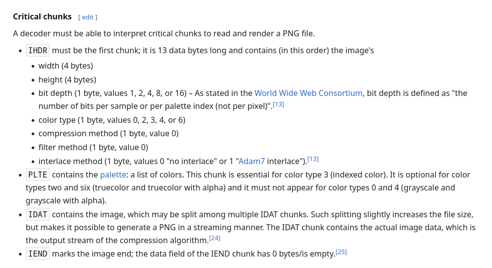
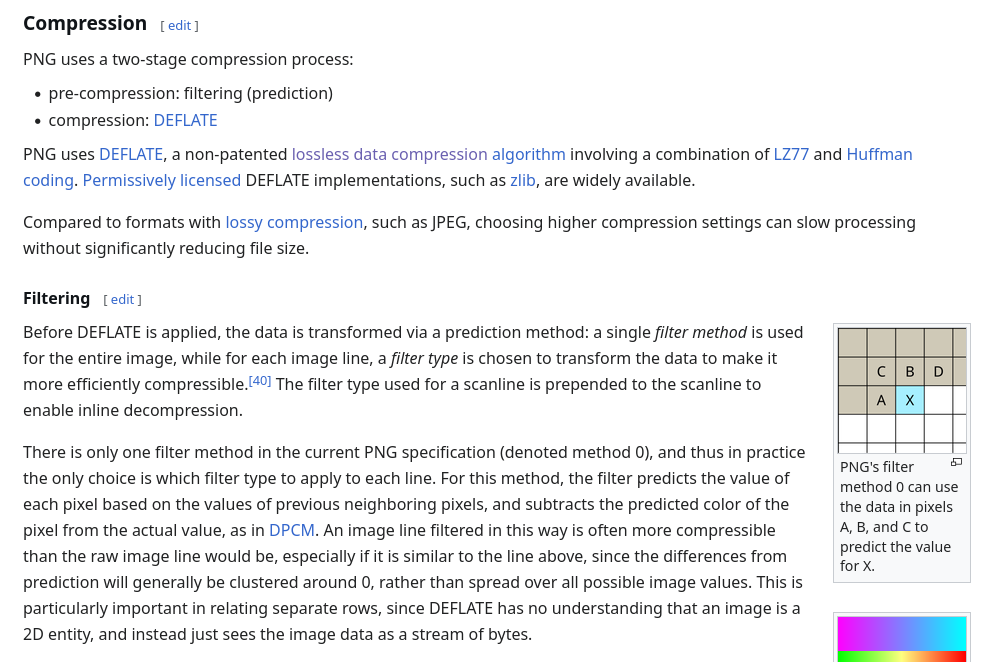
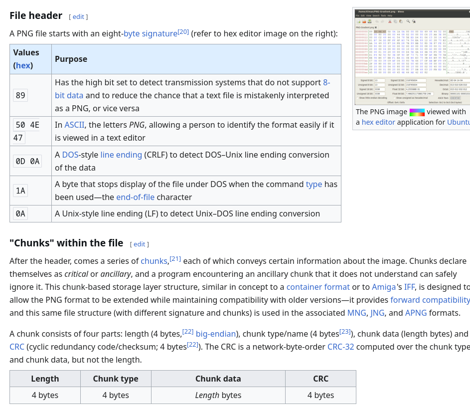
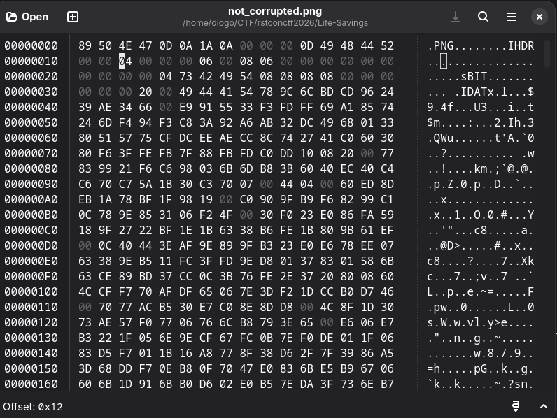

### Description

> Dude, my casino voucher photo got all corrupted and glitchy after I took it. It won't open on my phone or computer. Can you fix it fr fr??
> Gambling involves significant risk of financial loss and should only be undertaken by adults who can afford to lose what they wager and who gamble responsibly.

### Solution

The challenge provides a corrupted PNG image that cannot be opened:

```
file corrupted.png
corrupted.png: PNG image data, 0 x 0, 8-bit/color RGBA, non-interlaced

pngcheck -vv corrupted.png
File: corrupted.png (2182646 bytes)
  chunk IHDR at offset 0x0000c, length 13:  invalid image dimensions (0x0)
ERRORS DETECTED in corrupted.png
```



#### First attempt: CRC brute force

After reading up on the IHDR chunk and the overall [PNG file format](https://en.wikipedia.org/wiki/PNG#File_format), it became clear that the width and height fields in the IHDR chunk had been set to 0×0.

My first approach was to use **PCRT** to recover the image dimensions. The tool finds the width and height by brute force, testing combinations until the IHDR CRC matches.

```
python3 ~/PCRT/PCRT.py -v -y -i corrupted.png -o not_corrupted.png
[Finished] Correct PNG header
b'\x00\x00\x00\x00\x00\x00\x00\x00\x08\x06\x00\x00\x00'
[Detected] Error IHDR CRC found! (offset: 0x1D)
chunk crc: 0x00000000
correct crc: 0x3B8B7C12
[Finished] IHDR chunk check complete (offset: 0x8)
[Finished] Correct IDAT chunk data length (offset: 0x31 length: 8192)
[Detected] Error IDAT CRC found! (offset: 0x2039)
chunk crc: 0x00000000
correct crc: 0xFC7428A5
[Finished] Successfully fix crc
...
[Finished] Correct IDAT chunk data length (offset: 0x214CA9 length: 309)
[Detected] Error IDAT CRC found! (offset: 0x214DE6)
chunk crc: 0x00000000
correct crc: 0x80E7A482
[Finished] Successfully fix crc
[Finished] IDAT chunk check complete (offset: 0x31)
[Detected] Error IEND chunk! Try auto fixing...
[Finished] Now IEND chunk:0x0000000049454E44AE426082
...
PIL.UnidentifiedImageError: cannot identify image file 'not_corrupted.png'
```

The output shows that the dimensions were not the only problem: **every CRC in the file had also been zeroed**, including the IHDR, every IDAT and the IEND.

PCRT managed to fix the IDAT CRCs and rebuild the IEND chunk, but it left the IHDR untouched, still at 0×0. The reported `correct crc: 0x3B8B7C12` is simply the CRC of the header as it currently stands, with zeroed dimensions.

This means that CRC-based brute forcing cannot work here. Without the original IHDR CRC, there is nothing to test the candidate width/height combinations against. The only remaining option is to derive the dimensions from the image data itself.

#### Deriving the dimensions from the image data

The rest of the IHDR chunk is intact: `08 06 00 00 00` means 8 bits per channel, colour type 6 (RGBA, 4 bytes per pixel) and no interlacing.



In a PNG, the data from all IDAT chunks together forms a single zlib stream. Once decompressed, it contains one row of bytes for each row of the image, and each row starts with a 1-byte filter type followed by 4 bytes per pixel (RGBA). The total decompressed size is therefore:

```
size = height × (1 + 4 × width)
```

With that in mind, I concatenated the IDAT data and decompressed it, following the structure described on Wikipedia:



```
import zlib,struct
d=open('not_corrupted.png','rb').read();p=8;z=b''
while p<len(d):
  n=struct.unpack('>I',d[p:p+4])[0]
  if d[p+4:p+8]==b'IDAT':z+=d[p+8:p+8+n]
  p+=12+n
print(len(zlib.decompress(z)))
```

The script walks through the chunks, concatenates the IDAT payloads and decompresses them, giving a total size of **6,292,992 bytes**.

Factorising this value gives 6,292,992 = 2⁹ × 3 × 17 × 241.

The row length, `1 + 4 × width`, is always odd, so it must divide the odd part of the total: 3 × 17 × 241 = 12,291. The odd divisors are 1, 3, 17, 51, 241, 723, 4097 and 12,291. Of these, only the ones that leave a remainder of 1 when divided by 4 produce an integer width:

| 1 + 4 × width | Width | Height  |
| ------------- | ----- | ------- |
| 17            | 4     | 370 176 |
| 241           | 60    | 26 112  |
| 4097          | 1024  | 1536    |

The only plausible option is **1024 × 1536**, a portrait image.

1024 = `0x400` and 1536 = `0x600`. In the IHDR chunk, width and height each take up 4 bytes in big-endian order, starting at offset `0x10`. I patched these bytes using ghex.



#### Fixing the IHDR CRC

With the correct dimensions in place, the only thing left is the IHDR CRC, which is still zeroed. This time PCRT is able to compute it, because the header now contains the real values:

```
python3 ~/PCRT/PCRT.py -v -y -i not_corrupted.png -o fixed.png
[Finished] Correct PNG header
b'\x00\x00\x04\x00\x00\x00\x06\x00\x08\x06\x00\x00\x00'
[Detected] Error IHDR CRC found! (offset: 0x1D)
chunk crc: 0x00000000
correct crc: 0xE8823AAA
[Finished] Successfully fix crc
[Finished] IHDR chunk check complete (offset: 0x8)
[Finished] Correct IDAT chunk data length (offset: 0x31 length: 8192)
[Finished] Correct IDAT CRC (offset: 0x2039): 0xFC7428A5
...
```

The IDAT and IEND chunks had already been fixed during the first pass, so only the IHDR is modified this time. The file now opens correctly and reveals the flag:


