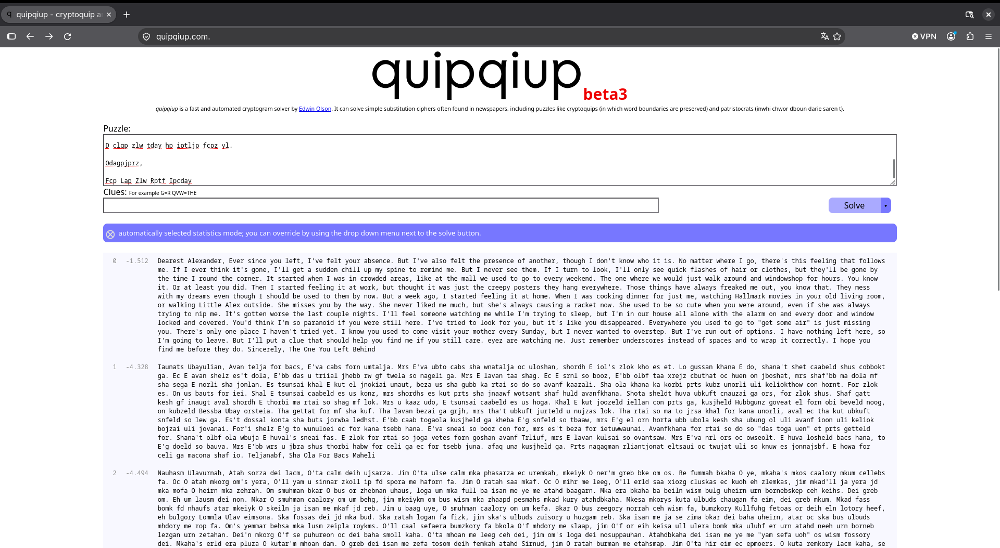

### Description

> A letter is found beside a tombstone in a graveyard, but it seems to have been scrambled around

### Solution

The challenge provides a file, `graveyard_letter.txt`, with the following contents:

```
Ypejpof Erpveaypj,

Pmpj odagp zlw rptf, D'mp tprf zlwj eiopagp. Iwf D'mp erol tprf fcp qjpopagp lt ealfcpj, fclwuc D yla'f nalx xcl df do. Al heffpj xcpjp D ul, fcpjp'o fcdo tpprdau fcef tlrrlxo hp. Dt D pmpj fcdan df'o ulap, D'rr upf e owyypa gcdrr wq hz oqdap fl jphday hp. Iwf D apmpj opp fcph. Dt D fwja fl rlln, D'rr larz opp kwdgn treocpo lt cedj lj grlfcpo, iwf fcpz'rr ip ulap iz fcp fdhp D jlway fcp gljapj.

Df ofejfpy xcpa D xeo da gjlxypy ejpeo, rdnp ef fcp herr xp wopy fl ul fl pmpjz xppnpay. Fcp lap xcpjp xp xlwry bwof xern ejlway eay xdaylxoclq tlj clwjo. Zlw nalx df. Lj ef rpeof zlw ydy. Fcpa D ofejfpy tpprdau df ef xljn, iwf fclwucf df xeo bwof fcp gjppqz qlofpjo fcpz ceau pmpjzxcpjp. Fclop fcdauo cemp erxezo tjpenpy hp lwf, zlw nalx fcef. Fcpz hpoo xdfc hz yjpeho pmpa fclwuc D oclwry ip wopy fl fcph iz alx.

Iwf e xppn eul, D ofejfpy tpprdau df ef clhp. Xcpa D xeo gllndau ydaapj tlj bwof hp, xefgcdau Cerrhejn hlmdpo da zlwj lry rdmdau jllh, lj xerndau Rdffrp Erpv lwfodyp. Ocp hdoopo zlw iz fcp xez. Ocp apmpj rdnpy hp hwgc, iwf ocp'o erxezo gewodau e jegnpf alx. Ocp wopy fl ip ol gwfp xcpa zlw xpjp ejlway, pmpa dt ocp xeo erxezo fjzdau fl adq hp.

Df'o ulffpa xljop fcp reof glwqrp aducfo. D'rr tppr olhplap xefgcdau hp xcdrp D'h fjzdau fl orppq, iwf D'h da lwj clwop err erlap xdfc fcp erejh la eay pmpjz yllj eay xdaylx rlgnpy eay glmpjpy. Zlw'y fcdan D'h ol qejealdy dt zlw xpjp ofdrr cpjp. 

D'mp fjdpy fl rlln tlj zlw, iwf df'o rdnp zlw ydoeqqpejpy. Pmpjzxcpjp zlw wopy fl ul fl "upf olhp edj" do bwof hdoodau zlw. Fcpjp'o larz lap qregp D cempa'f fjdpy zpf. D nalx zlw wopy fl glhp mdodf zlwj hlfcpj pmpjz Owayez, iwf D apmpj xeafpy fl lmpjofpq. Iwf D'mp jwa lwf lt lqfdlao. D cemp alfcdau rptf cpjp, ol D'h uldau fl rpemp. Iwf D'rr qwf e grwp fcef oclwry cprq zlw tday hp dt zlw ofdrr gejp.

pzps ejp xefgcdau hp. Bwof jphphipj waypjogljpo daofpey lt oqegpo eay fl xjeq df gljjpgfrz.

D clqp zlw tday hp iptljp fcpz yl.

Odagpjprz,

Fcp Lap Zlw Rptf Ipcday
```

#### Identifying the cipher

The letter keeps its entire structure intact: a greeting followed by a comma, separate paragraphs, apostrophes (`D'mp`, `zlw'y`) and a signature at the end. Only the letters themselves have been swapped. In addition, the same ciphertext words appear repeatedly and are always encrypted in exactly the same way; `zlw`, for example, shows up many times throughout the text.

These are the defining characteristics of a **monoalphabetic substitution cipher**.

#### Breaking the cipher

Substitution ciphers like this one can be broken through frequency analysis, so I pasted the text into [quipqiup](https://quipqiup.com), an automated cryptogram solver:



The top result returned by the site was the following plaintext:

```
Dearest Alexander, Ever since you left, I've felt your absence. But I've also felt the presence of another, though I don't know who it is. No matter where I go, there's this feeling that follows me. If I ever think it's gone, I'll get a sudden chill up my spine to remind me. But I never see them. If I turn to look, I'll only see quick flashes of hair or clothes, but they'll be gone by the time I round the corner. It started when I was in crowded areas, like at the mall we used to go to every weekend. The one where we would just walk around and windowshop for hours. You know it. Or at least you did. Then I started feeling it at work, but thought it was just the creepy posters they hang everywhere. Those things have always freaked me out, you know that. They mess with my dreams even though I should be used to them by now. But a week ago, I started feeling it at home. When I was cooking dinner for just me, watching Hallmark movies in your old living room, or walking Little Alex outside. She misses you by the way. She never liked me much, but she's always causing a racket now. She used to be so cute when you were around, even if she was always trying to nip me. It's gotten worse the last couple nights. I'll feel someone watching me while I'm trying to sleep, but I'm in our house all alone with the alarm on and every door and window locked and covered. You'd think I'm so paranoid if you were still here. I've tried to look for you, but it's like you disappeared. Everywhere you used to go to "get some air" is just missing you. There's only one place I haven't tried yet. I know you used to come visit your mother every Sunday, but I never wanted to overstep. But I've run out of options. I have nothing left here, so I'm going to leave. But I'll put a clue that should help you find me if you still care. eyez are watching me. Just remember underscores instead of spaces and to wrap it correctly. I hope you find me before they do. Sincerely, The One You Left Behind
```

#### Finding the flag

While reading through the decrypted letter, one sentence immediately stands out because it is written entirely in lowercase: *"eyez are watching me"*. The sentence that follows it also explains the expected format: underscores instead of spaces, wrapped in the flag format.

Following these instructions, I submitted the flag below, which solved the challenge.

